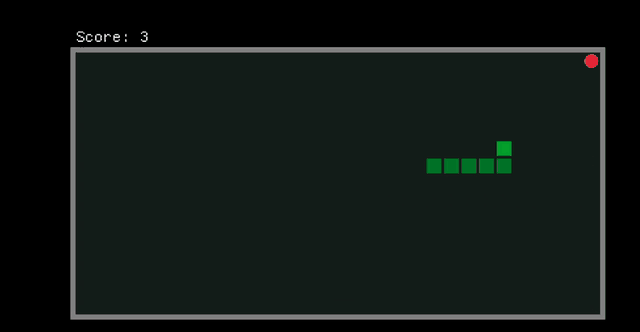

# Snake in Rust, on Android

<p align="center">
  
  <br>
  <em>Recorded on an Android 16 phone. For the recording, a small autopilot steered the snake.</em>
</p>

This repository is the result of an experiment: **what does it take to get a working
Android app written in Rust, starting with no Rust experience at all?** It was started
by a developer with a background in software development (mainly Java) who had never
written Rust before. The code was written together with Claude Code, an AI coding
assistant, and tested on a real phone.

The app is a small Snake game. The interesting part isn't the game, but the path from a
first Rust program to an app on a phone, and what broke along the way. That story is
below.

## Contents

| Path | What it is |
|---|---|
| [`snake-mobile/`](snake-mobile) | The Android app (also runs as a desktop window), built with [macroquad](https://github.com/not-fl3/macroquad) |
| [`snake-mobile/android/Dockerfile`](snake-mobile/android/Dockerfile) | The build environment: Rust, Android SDK and NDK, and [cargo-quad-apk](https://github.com/not-fl3/cargo-quad-apk), with pinned versions |
| [`snake-mobile/build-apk.sh`](snake-mobile/build-apk.sh) | Builds the APK inside that image |
| [`src/main.rs`](src/main.rs) | The first version: the same game in the terminal, with comments for Java developers |

## Running it

### On an Android phone

You need [Docker](https://www.docker.com/), `adb` (from the Android SDK platform tools,
e.g. `brew install android-platform-tools`), and a phone with USB debugging turned on.

```sh
snake-mobile/build-apk.sh
adb install -r snake-mobile/target/android-artifacts/release/apk/snake-mobile.apk
```

The first build creates the Docker image, which takes about 6 minutes on an Apple Silicon
Mac (the Android NDK is only available for x86_64 Linux, so Docker emulates it). After
that, a build takes about 40 seconds. Nothing besides Docker needs to be installed on the
computer.

**Controls:** swipe to steer, tap to play again after game over, back button to quit.

### As a desktop window

With [Rust](https://rustup.rs/) installed:

```sh
cd snake-mobile
cargo run
```

Drag with the mouse to steer, or use the arrow keys / WASD.

### In the terminal

```sh
cargo run
```

Arrow keys or WASD to steer, R to restart, Q or Esc to quit.

## How it went

### 1. A first Rust program, in the terminal

The first goal was a Snake game in the terminal, written to be easy to read for someone
who knows Java. The comments compare Rust to Java wherever there's a useful comparison:
`VecDeque` and `ArrayDeque`, `#[derive(PartialEq)]` and a generated `equals()`, `Result`
and `?` instead of exceptions, traits and interfaces.

Most of the early questions were about the parts of Rust with no Java equivalent: values
being *moved* on assignment unless a type is `Copy`, traits that must be imported before
their methods can be called (`use rand::RngExt;`), and macros. One small refactor came
straight from that: Rust has no half-constructed objects, so instead of creating the
game with a placeholder value and fixing it afterwards, the helper became a function
that runs before the struct is built.

### 2. From terminal to phone

For the Android version, the game was moved onto macroquad, a small 2D game library that
runs on desktop and Android with the same code. The game rules (`Direction`, `Point`,
`Game`) were copied over unchanged. Only three things had to change:

- **Drawing:** coloured squares sized to fit the screen, instead of characters.
- **Input:** swipes, detected from touch movement, with arrow keys still working on a computer.
- **Timing:** the snake moves every 150 ms of accumulated frame time, instead of waiting on keyboard input.

Because macroquad also runs on macOS, the app could be tested in a desktop window before
going anywhere near a phone.

### 3. The first APK: old build tools, new libraries

macroquad's Android instructions use a ready-made Docker image with everything needed to
build an APK. That image turned out to be from 2024, with Rust 1.79. Since the Rust compiler and
the libraries had moved on, the first builds failed one after another:

1. The image's build tool couldn't read the newer `Cargo.lock` format.
   Setting `rust-version = "1.79"` made Cargo write the old format.
2. A font library (`fontdue` 0.9.4) used a language feature that only arrived in Rust 1.87,
   without declaring it, so Cargo had no way to avoid it.
3. macroquad's latest version itself needed a newer compiler.
   Pinning macroquad to 0.4.11 (July 2024, from the same time as the image) solved 2 and 3.

The APK then built. Checking its manifest before installing it found a fourth problem:
apps targeting Android 12 or newer must declare `android:exported` on their start
screen, or Android refuses to install them, and the build tool didn't add it. One line in
`Cargo.toml` fixed it. One more problem showed up: every build created a new signing key,
which would have stopped Android from accepting updates. The key is now kept in a local,
git-ignored folder.

### 4. Getting it onto the phone

When the phone was connected, it showed "charging only", and the Mac didn't see it as a
debugging device. Its USB interfaces showed only file transfer and serial, with no ADB.
Once USB debugging was enabled and the computer allowed on the phone, `adb install`
worked, and the first screenshot from the phone showed the game running and being played.

### 5. The back button, three times

The back button did nothing. The reason was in macroquad's Android layer (miniquad):
its Java view took *every* key event for the game and never passed it on, and its Rust
"quit" function didn't do anything on Android in that version.

- **Attempt 1, in Java.** The build tool can inject Java code into the app's main activity.
  A `dispatchKeyEvent` override caught Back before the view did, and closed the screen.
  It worked, but *reopening* the app crashed. Android had kept the process alive, and
  macroquad can only be set up once per process. Ending the process on Back fixed that.
- **Attempt 2, in Rust, after upgrading (next section).** Newer miniquad versions report
  Back as `KeyCode::Back`, so the Java code could go.
- **Attempt 3, still in Rust.** Ending the process with `std::process::exit` worked visibly,
  but the phone's crash log showed an abort on every exit: Rust's exit runs cleanup code
  while Android's rendering threads are still running. Calling the C library's `_exit`,
  which skips that cleanup, removed the crash. This bug was invisible on the screen and
  was only found by reading the crash log.

### 6. Upgrading everything

Finally, everything was moved to current versions: Rust 1.99.1, the latest macroquad and
miniquad, and the latest crates in the terminal game (`rand` 0.10 had renamed some of its
functions). The APK build tool had been updated in the meantime, but its published
Dockerfile still installed Rust 1.79, so this repository has its own
[`Dockerfile`](snake-mobile/android/Dockerfile) with every version pinned. Two more
issues came up:

- **Arch Linux's package manager** refuses to run its download sandbox under Docker's
  x86_64 emulation. `--disable-sandbox` is safe inside a throwaway build container.
- **Android 16 "predictive back".** The new build tool targets Android 16, and apps that
  target Android 16 no longer receive Back as a key press. The manifest setting
  `android:enableOnBackInvokedCallback="false"` opts the game out, so Rust sees
  `KeyCode::Back` again.

Each change was tested on the phone with a scripted `adb` check: open the app, press
Back, confirm the process has ended, three rounds in a row, then confirm the crash log
is empty.

## Lessons learned

- **The Rust part was the easy part.** The game logic went from terminal to phone
  unchanged, and the game code itself never needed debugging.
- **The hard part is where Rust meets the platform.** Every bug that needed debugging was
  at a boundary: the build tooling, the Java activity, the C library, Android's lifecycle.
- **The Rust-on-Android ecosystem is small, and versions drift.** Tools, libraries and
  the compiler move at different speeds. Pinning exact versions in one Dockerfile keeps
  builds reproducible.
- **Android platform changes affect even tiny apps.** Two of the fixes (`exported` since
  Android 12, predictive back since Android 16) were about the Android version, not the code.
- **Test on a real device and read the logs.** Two of the bugs never showed up on the screen.

## Versions used

As of October 2026:

| Component | Version |
|---|---|
| Rust | 1.99.1 |
| macroquad / miniquad | 0.4.16 / 0.4.11 |
| cargo-quad-apk | commit `d411c8f` (July 2026) |
| Android NDK | 30.0.16248370 |
| Android build tools | 37.0.0 |
| Target Android version | 16 (API 36), minimum Android 4.3 (API 18) |
| Terminal game | crossterm 0.29, rand 0.10 |

## Limitations

- The APK is signed with a debug key, which is fine for installing on your own phone,
  but not for Google Play.
- Only 64-bit ARM (`arm64-v8a`) is built, which covers practically all current phones.
- Back ends the process immediately. That's deliberate (see above), and the game has no
  state to save.
